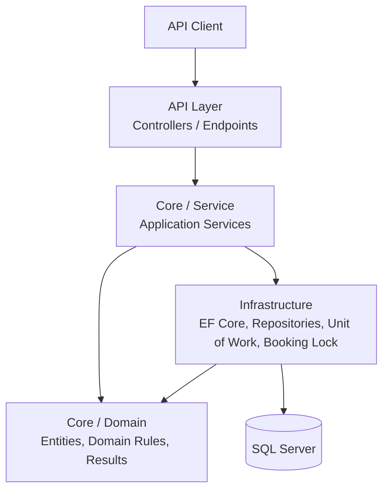
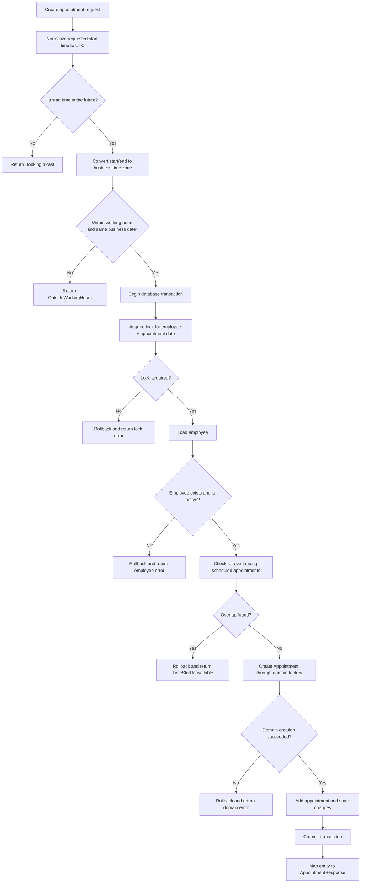
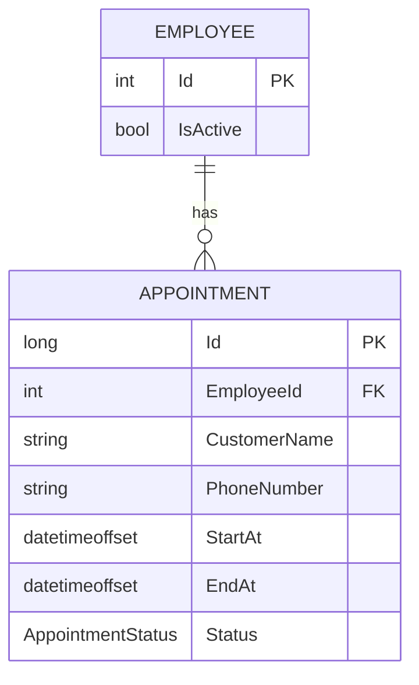

# Appointment Booking API

A backend API for managing employee appointments. The system is built with ASP.NET Core and follows an Onion Architecture approach, keeping business rules separate from application services and infrastructure concerns.

## Table of Contents

- [Overview](#overview)
- [Core Features](#core-features)
- [Technology Stack](#technology-stack)
- [Architecture](#architecture)
- [Rich Domain Models](#rich-domain-models)
- [Booking Workflow](#booking-workflow)
- [Concurrency and Double Booking](#concurrency-and-double-booking)
- [Appointment Time Handling](#appointment-time-handling)
- [Domain Model](#domain-model)
- [Application Services](#application-services)
- [Booking Configuration](#booking-configuration)
- [API Capabilities](#api-capabilities)
- [Error Handling](#error-handling)
- [Running the Project](#running-the-project)
- [Important Implementation Notes](#important-implementation-notes)

## Overview

The API supports the main operations involved in an employee appointment booking process:

1. Create an appointment for an active employee.
2. Retrieve available time slots for an employee on a specific date.
3. Retrieve an employee's scheduled appointments for a date, with pagination.
4. Cancel an existing appointment.

The application stores appointment timestamps as UTC instants and uses a configured business time zone when validating working hours and building an employee's daily schedule.

## Core Features

- **Appointment creation:** validates the requested time, employee availability, working hours, and overlapping appointments.
- **Available slots:** generates candidate slots based on working hours and the configured slot interval.
- **Employee schedule:** returns scheduled appointments for a selected date with pagination.
- **Appointment cancellation:** applies cancellation through the domain model rather than changing the status directly in the service.
- **Overlap detection:** checks whether a scheduled appointment intersects the requested time interval.
- **Concurrency protection:** uses a booking-lock abstraction inside a database transaction before checking and creating a booking.
- **Consistent result handling:** application services return `Result` / `Result<T>` values for expected business failures.
- **Time-zone-aware scheduling:** converts between UTC and the configured business time zone.

## Technology Stack

The following technologies and patterns are visible in the implementation shared for this project.

| Area | Technology / Approach |
|---|---|
| Language | C# |
| Backend | ASP.NET Core |
| ORM | Entity Framework Core |
| Database | SQL Server (the booking lock work was discussed as SQL Server-specific) |
| Architecture | Onion Architecture |
| Application services | Service abstractions and implementations |
| Data access | Repository Pattern and Unit of Work |
| Object mapping | AutoMapper |
| Error handling | Result Pattern |
| Time handling | `DateTimeOffset`, `TimeZoneInfo`, `TimeProvider` |
| Concurrency | Transaction + `IBookingLockProvider` abstraction |
| API documentation | Swagger / OpenAPI |

Package versions and exact framework/database versions should be added from the project files.

## Architecture

The project follows the Onion Architecture direction: the domain model is kept at the center, while application and infrastructure concerns depend inward on abstractions.



### Main responsibilities

| Layer | Responsibility |
|---|---|
| API | Receives HTTP requests, invokes application services, and translates results into HTTP responses. |
| Core / Service | Coordinates use cases such as creating, listing, and cancelling appointments. |
| Core / Domain | Holds business entities, domain behavior, and business errors. |
| Infrastructure | Implements persistence, repository/unit-of-work behavior, transactions, and the booking-lock provider. |
| Database | Persists employees and appointments. |

The exact folder and project names should be aligned with the actual solution structure.

## Rich Domain Model Design

The project follows the Rich Domain Model approach instead of treating entities as simple data containers.

Domain entities encapsulate their own business rules and state transitions, keeping the domain logic close to the data it protects.

For example, the `Appointment` entity is responsible for managing its lifecycle through domain methods such as `Cancel()`. This ensures that an appointment cannot transition to an invalid state, regardless of which application service invokes the operation.

### Key Principles

- **Encapsulation:** Entity properties use private setters to prevent uncontrolled state modifications.
- **Business Invariants:** Rules that protect an entity's valid state are enforced within the domain model.
- **Controlled State Transitions:** Changes to entity state happen through explicit domain methods.
- **Separation of Concerns:** Application services coordinate use cases and external dependencies, while entities protect domain-specific rules.

This keeps business rules centralized and makes the domain model more consistent and easier to maintain.

## Booking Workflow

The creation flow validates the requested time before entering the transaction. It then acquires the employee/date booking lock, checks the employee and existing appointments, creates the domain entity, saves the changes, and commits.



## Concurrency and Double Booking

Checking for an overlapping appointment is not enough by itself when multiple requests can arrive at nearly the same time.

For example:

1. Request A checks a time slot and finds no appointment.
2. Request B checks the same slot and also finds no appointment.
3. Both requests attempt to create an appointment.

Without coordination, both requests could pass the overlap check.

The current creation flow addresses this by:

1. Starting a database transaction.
2. Acquiring a booking lock using the employee ID and the appointment's business-local date.
3. Checking for overlapping scheduled appointments while the lock is held.
4. Saving and committing the appointment before the transaction ends.

The same lock abstraction is also used during cancellation. The cancellation flow re-reads the appointment after acquiring the lock, then applies the domain cancellation operation.

`IBookingLockProvider` is the application-facing abstraction. The exact SQL statement, lock resource format, lock timeout, and lock ownership settings should be documented from its implementation rather than assumed here.

### Overlap rule

Two time intervals overlap when:

```text
existing.StartAt < requested.EndAt
AND
existing.EndAt > requested.StartAt
```

This allows back-to-back appointments. For example, an appointment ending at 10:30 does not overlap another appointment starting at 10:30.

## Appointment Time Handling

The application distinguishes between:

- **UTC timestamps:** used for storing and comparing appointment instants.
- **Business-local time:** used to validate working hours and determine the employee's schedule date.
- **Configured time zone:** defines the local business clock.

The service uses `TimeZoneInfo` to convert between UTC and the configured business time zone. It also uses `TimeProvider` to obtain the current time, which makes time-dependent behavior easier to test.

### Important API contract detail

The create service currently calls `ToUniversalTime()` on the request's `StartAt`. This is safe only when the incoming value has the intended time-zone semantics.

For an instant-based API, send an explicit offset or UTC marker:

```json
{
  "startAt": "2026-11-06T08:00:00Z"
}
```

or:

```json
{
  "startAt": "2026-11-06T10:00:00+02:00"
}
```

These two values represent the same instant.

Avoid sending an offset-less timestamp such as:

```json
{
  "startAt": "2026-11-06T10:00:00"
}
```

An offset-less value does not identify a unique instant. In particular, calling `ToUniversalTime()` on a `DateTime` with `Kind == Unspecified` makes .NET interpret it using the server machine's local time zone, which may differ between development and production.

If the intended contract is instead "the customer chooses a wall-clock time in the business time zone", the API should accept a local date and time and explicitly interpret them using the configured business time zone. Do not mix that contract with an arbitrary client-provided offset.

## Domain Model

The following diagram contains only the relationship and fields that are evident from the service implementation. Additional properties and constraints should be added after checking the actual entities and EF Core configurations.



### Appointment lifecycle

The service queries appointments with `Scheduled` status when checking conflicts, generating available slots, and retrieving the employee's schedule.

Cancellation is performed through the domain method `Appointment.Cancel(...)`. The exact allowed state transitions and cancellation rules belong to the domain implementation and are not inferred here.

## Application Services

### `CreateAppointmentAsync`

- Converts the requested start time to UTC and calculates the end time from the requested duration.
- Rejects appointments that start in the past.
- Converts the interval to the configured business time zone.
- Rejects appointments that cross a business-local date or fall outside working hours.
- Starts a transaction and acquires the employee/date booking lock.
- Checks that the employee exists and is active.
- Checks for an overlapping scheduled appointment.
- Creates the appointment through `Appointment.Create(...)`.
- Saves, commits, and maps the entity to `AppointmentResponse`.

### `GetAvailableSlotsAsync`

- Accepts an employee ID, a date, and a requested duration.
- Validates that the duration is between 15 and 120 minutes.
- Checks that the employee exists and is active.
- Converts the configured working-hours boundaries for the requested date to UTC.
- Loads scheduled appointments overlapping the working interval.
- Generates candidate slots using `SlotIntervalMinutes`.
- Returns only future slots that do not overlap existing scheduled appointments.

### `GetEmployeeScheduleAsync`

- Validates the page number and page size. The current service rejects page sizes greater than 100.
- Checks that the employee exists.
- Converts the selected business-local working interval to UTC.
- Queries scheduled appointments whose start time falls within that interval.
- Counts the matching records, orders by start time, and applies `Skip` / `Take`.
- Maps the entities to `EmployeeAppointmentResponse` and returns a `PagedResult`.

### `CancelAppointmentAsync`

- Starts a transaction and loads the appointment.
- Converts its start time to the business time zone to determine the appointment date.
- Acquires the employee/date booking lock.
- Re-reads the appointment after acquiring the lock.
- Calls `Appointment.Cancel(...)` using the current UTC time from `TimeProvider`.
- Saves and commits if the domain operation succeeds.

## Booking Configuration

The service reads `BookingSettings` through `IOptions<BookingSettings>`.

| Setting | Purpose |
|---|---|
| `WorkingStart` | Local business opening time. |
| `WorkingEnd` | Local business closing time. |
| `TimeZone` | Business time zone used for scheduling and validation. |
| `SlotIntervalMinutes` | Step used when generating candidate available slots. |

The exact configuration values and their source (for example, `appsettings.json` or environment variables) should be copied from the application configuration.

## API Capabilities

The application service layer supports the following operations. Exact HTTP routes, verbs, status codes, and query parameter names should be copied from the actual controllers/endpoints.

| Operation | Inputs | Output |
|---|---|---|
| Create appointment | Customer details, employee ID, start time, duration | `AppointmentResponse` |
| Get available slots | Employee ID, date, duration | List of `AvailableSlotResponse` |
| Get employee schedule | Employee ID, date, page number, page size | `PagedResult<EmployeeAppointmentResponse>` |
| Cancel appointment | Appointment ID (`long`) | Result indicating success or failure |

## Error Handling

Expected business failures are represented using the Result Pattern instead of being treated as unexpected exceptions.

Examples of failure conditions visible in the service implementation include:

- Booking starts in the past.
- Requested time is outside working hours.
- Requested duration is outside the accepted range.
- Employee does not exist.
- Employee is inactive.
- Requested interval overlaps an existing scheduled appointment.
- Booking lock cannot be acquired.
- Pagination parameters are invalid.
- Appointment does not exist or cannot be cancelled according to its domain rules.

The API layer is responsible for translating application results into HTTP responses. The exact error codes and response envelope should be documented from the shared API response and result-to-HTTP mapping implementation.

### Logging Dashboard with Serilog UI

The project integrates **Serilog UI** to provide a centralized dashboard for inspecting and monitoring application logs stored in a PostgreSQL database.

It simplifies troubleshooting by providing a web-based interface where developers can browse and inspect log events without manually querying the logging database.

**Key Features:**

- **PostgreSQL Integration:** Stores application logs in a dedicated PostgreSQL database table.
- **Centralized Log Inspection:** Provides a dashboard for browsing and investigating logged events.
- **Custom Authorization:** Implements a custom authorization filter using Basic Authentication to restrict access to the logging dashboard.
- **Configuration-Based Credentials:** Keeps dashboard credentials in application configuration instead of hardcoding them into the authorization logic.

**Dashboard Endpoint:**

```http
/serilog-ui
```

**Architecture Overview:**

```text
Application
    |
    v
Serilog Logging
    |
    v
PostgreSQL Log Storage
    |
    v
Serilog UI Dashboard
    |
    v
Custom Authorization Filter
    |
    v
Log Inspection Interface
```

### Logging Dashboard with Serilog UI

The project integrates **Serilog UI** to provide a centralized dashboard for inspecting and monitoring application logs stored in a PostgreSQL database.

It simplifies troubleshooting by providing a web-based interface where developers can browse and inspect log events without manually querying the logging database.

**Key Features:**

- **SQL Server Integration:** Stores application logs in a dedicated SQL Server database table.
- **Centralized Log Inspection:** Provides a dashboard for browsing and investigating logged events.
- **Custom Authorization:** Implements a custom authorization filter using Basic Authentication to restrict access to the logging dashboard.
- **Configuration-Based Credentials:** Keeps dashboard credentials in application configuration instead of hardcoding them into the authorization logic.
- **Access:** baseUrl/serilog-ui

**Dashboard Endpoint:**

```http
/serilog-ui
```

**Architecture Overview:**

```text
Application
    |
    v
Serilog Logging
    |
    v
PostgreSQL Log Storage
    |
    v
Serilog UI Dashboard
    |
    v
Custom Authorization Filter
    |
    v
Log Inspection Interface
```

## Running the Project

The exact setup commands and required configuration keys were not present in the available source material. Use the following checklist when preparing the project locally:

1. Install the .NET SDK version targeted by the solution.
2. Configure the SQL Server connection string.
3. Configure the booking working hours and business time zone.
4. Configure the booking lock provider's database requirements.
5. Apply the Entity Framework Core migrations.
6. Run the API project.
7. Open the Swagger UI route configured by the application.

Do not commit real credentials or production connection strings. Use user secrets or environment variables for sensitive configuration.

## Important Implementation Notes

Before treating this README as the final technical reference, verify these items against the repository:

- [ ] Exact solution and project names and dependency direction.
- [ ] Actual `Employee` and `Appointment` properties and navigation properties.
- [ ] EF Core indexes, check constraints, delete behavior, and migration details.
- [ ] `IBookingLockProvider` implementation, SQL command, resource key, timeout, and lock ownership.
- [ ] DTO property types, especially the type and expected semantics of `StartAt`.
- [ ] Actual controller/endpoint routes, HTTP methods, and status codes.
- [ ] API response envelope and Result-to-HTTP mapping.
- [ ] Exception handling and validation pipeline.
- [ ] Exact .NET, EF Core, and SQL Server versions.
- [ ] Real configuration keys and safe local run instructions.

---

**Design principle:** availability checks are advisory; appointment creation must re-check availability while holding the booking lock. The database write is the point at which the booking is committed.
